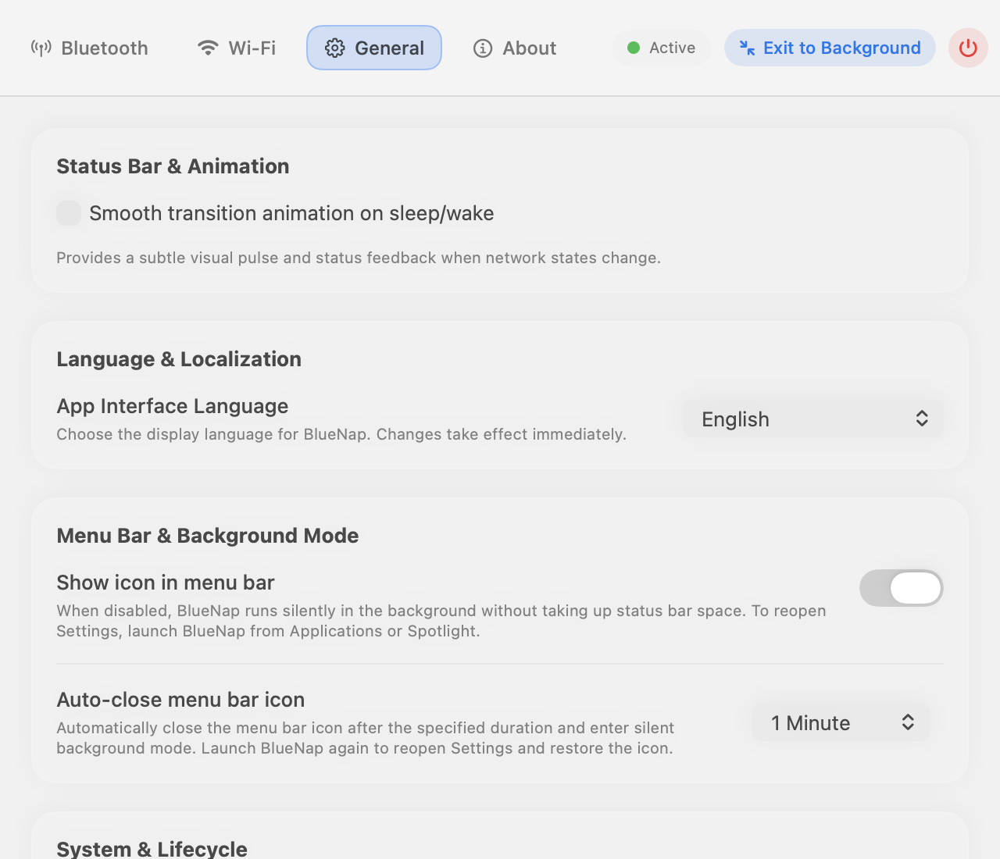
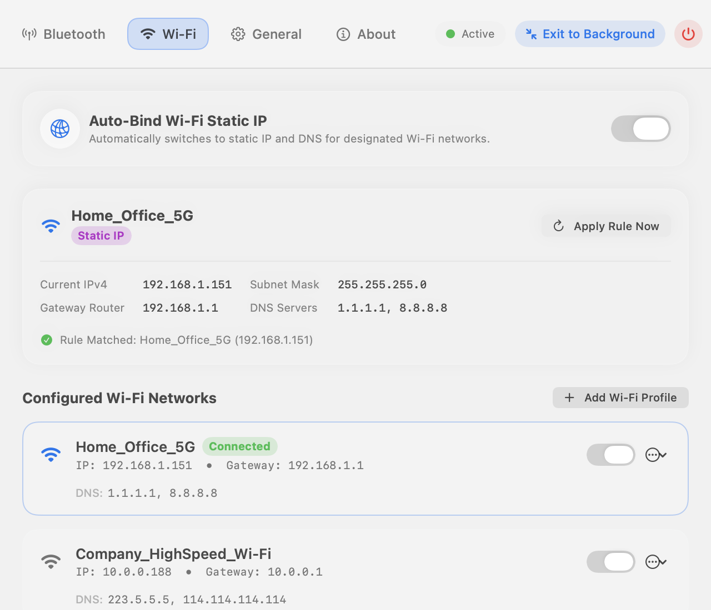
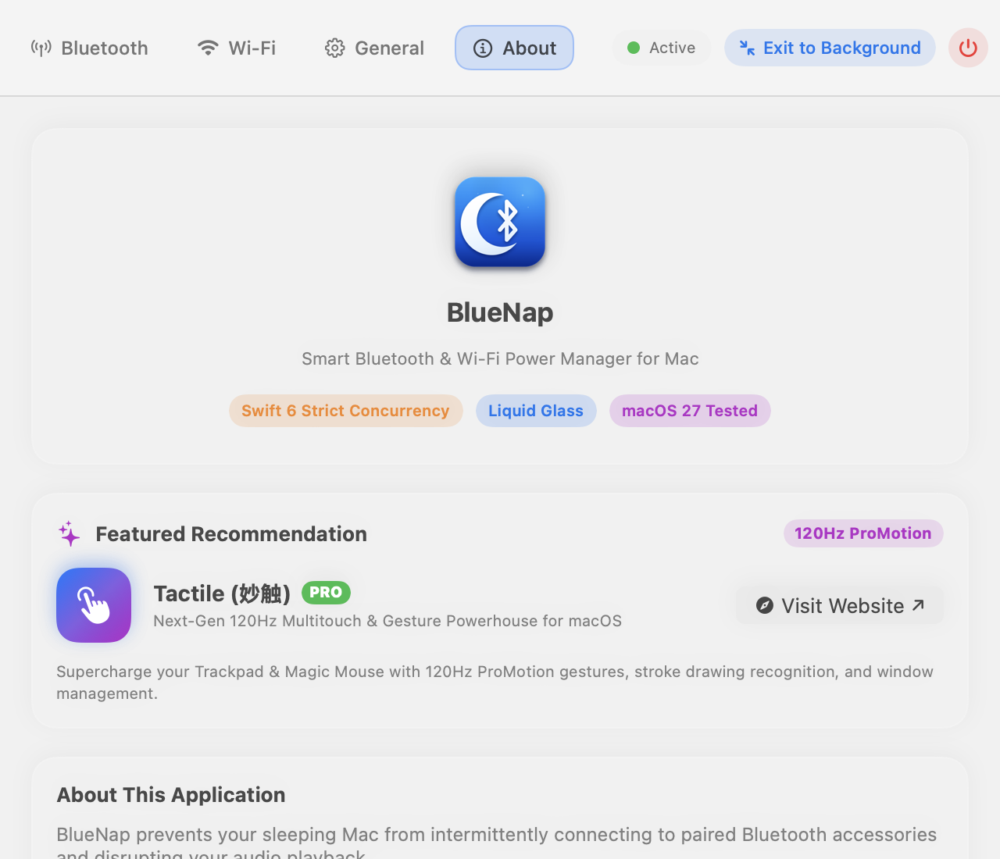

# BlueNap

<p align="center">
  <br />
  <b>Sleeping Mac, Silent Bluetooth & Intelligent Auto-WiFi.</b><br />
  <i>Intelligent Bluetooth & Wi-Fi Power Lifecycle Manager for macOS · AutoWiFi Static IP Engine · Silent Background Daemon</i>
</p>

<p align="center">
  <a href="https://www.needai.top/app/bluenap"></a>
  <a href="https://www.needai.top/app/tactile"></a>
  
  
  
  
  
  
  <a href="https://github.com/jorchford/BlueNap"></a>
  <a href="https://gitee.com/jorchford/BlueNap"></a>
</p>

<p align="center">
  <b>⚡ Fast Download Mirrors:</b><br />
  <a href="https://www.needai.top/downloads/BlueNap.app.zip">🌐 Official Site Direct (www.needai.top)</a> &nbsp;|&nbsp;
  <a href="https://gitee.com/jorchford/BlueNap/raw/main/downloads/BlueNap.app.zip">⚡ Gitee Fast Mirror (China)</a> &nbsp;|&nbsp;
  <a href="https://github.com/jorchford/BlueNap/releases">📦 GitHub Releases</a>
</p>

<p align="center">
  <b>Language Navigation:</b> &nbsp;
  <b>English</b> &nbsp;|&nbsp;
  <a href="README_ZH.md">简体中文</a> &nbsp;|&nbsp;
  <a href="README_ZH.md#繁體中文">繁體中文</a> &nbsp;|&nbsp;
  <a href="README_ZH.md#日本語">日本語</a>
</p>

---

## 📸 Screenshots Showcase (Default: English)

<div align="center">

### 1. General Preferences & Silent Background Mode
*Launch at login, auto-hide menu bar icon, and one-click Exit to Background with aggressive memory purge.*



<br /><br />

### 2. AutoWiFi Static IP Intelligent Auto-Binding
*Automatically identifies connected Wi-Fi SSIDs and applies customized static IP & DNS in milliseconds.*



<br /><br />

### 3. Bluetooth Sleep Management & Audio Hijacking Protection
*Prevents sleeping Mac from hijacking AirPods or Bluetooth speakers during maintenance wakeups.*


<br /><br />

### 4. About & Tactile Ecosystem Integration
*Swift 6 strict concurrency, Liquid Glass translucent aesthetics, and ecosystem recommendations.*



</div>

---

## 💡 Overview

**BlueNap** elegantly prevents your sleeping Mac from hijacking paired Bluetooth accessories and seamlessly automates your Wi-Fi network configuration.

When you share Bluetooth headphones, earbuds (such as AirPods), or speakers between your Mac and iPhone/iPad, a sleeping Mac can intermittently connect in the background during maintenance wakeups or power assertions, abruptly interrupting your audio or draining accessory battery.

**BlueNap provides an intuitive, serene solution:**
- **On Sleep**: BlueNap automatically disconnects selected audio accessories or gracefully switches off Bluetooth entirely.
- **On Wake & Unlock**: BlueNap restores your previous state seamlessly the instant you unlock your Mac.
- **AutoWiFi Intelligent Static IP**: Automatically switches between static IP configurations and DHCP based on your connected Wi-Fi SSID, powered by a native Swift LaunchDaemon with 0.0% idle CPU.
- **Input Peripherals Protection**: Automatically recognizes Bluetooth mice, keyboards, and trackpads to ensure they remain connected for wake gestures.
- **Exit to Background & Extreme Memory Efficiency**: Complete teardown of SwiftUI views and multi-stage Darwin malloc purge reduces background resident footprint to **~12.2 MB**.

---

## 🌟 Key Features (v2.2.0)

1. **Exit to Background & Silent Daemon Operation**
   - Added dedicated **Exit to Background** action in the menu bar directly above "Quit", and in Settings header.
   - When exiting or auto-closing, the menu bar icon hides, window resources are completely released, and BlueNap guards your hardware silently in the background.
2. **Dynamic In-App Language Switching**
   - Dedicated **Language** submenu in the menu bar with live checkmarks.
   - Instant runtime language switching (System, 简体中文, 繁體中文, English, 日本語) in Settings without app restart.
3. **AutoWiFi Subsystem**
   - Automatically switches between static IP configurations (IP, Subnet, Gateway, DNS) for designated Wi-Fi networks.
   - Seamlessly falls back to DHCP when disconnecting or switching to unconfigured networks.
4. **Deep Memory Optimization**
   - `NSHostingController` teardown resets the SwiftUI view hierarchy to `EmptyView()`, flushes CoreAnimation transactions, clears `URLCache`, and triggers system-wide Darwin malloc zone pressure relief.
5. **Zero Telemetry & 100% Privacy**
   - Fully local, offline execution with zero network tracking, external analytics, or data collection.

---

## 🚀 Installation & Download

### Option 1: Direct Download (Recommended)
Download the prebuilt, Apple-notarized app package:
- 🌐 **Official Website**: [https://www.needai.top/downloads/BlueNap.app.zip](https://www.needai.top/downloads/BlueNap.app.zip)
- ⚡ **Gitee Direct Mirror**: [https://gitee.com/jorchford/BlueNap/raw/main/downloads/BlueNap.app.zip](https://gitee.com/jorchford/BlueNap/raw/main/downloads/BlueNap.app.zip)
- 📦 **GitHub Releases**: [https://github.com/jorchford/BlueNap/releases](https://github.com/jorchford/BlueNap/releases)

Unzip `BlueNap.app.zip` and drag `BlueNap.app` into your `/Applications` directory.

### Option 2: Homebrew Cask (Coming Soon)
```bash
brew install --cask bluenap
```

---

## 🛠️ Building from Source

### Requirements
- macOS 14.0 or later
- Xcode 16.0+ (Swift 6.0 toolchain)

### Build Steps
```bash
# Clone the repository
git clone https://github.com/jorchford/BlueNap.git
cd BlueNap

# Build Release binary using xcodebuild
xcodebuild -project src/Bluesnooze.xcodeproj -scheme Bluesnooze -configuration Release clean build
```

The compiled `BlueNap.app` will be available in your Xcode DerivedData build products folder.

---

## 🤝 Featured Ecosystem App

Explore **[Tactile (妙触)](https://www.needai.top/app/tactile)** — Next-Generation 120Hz ProMotion Multitouch Gesture Powerhouse & Stroke Drawing Engine for macOS. Supercharge your trackpad and Magic Mouse with fluid gestures, stroke character recognition, and intuitive window snapping.

---

## 📄 License

BlueNap is free and open-source software licensed under the [GNU General Public License v3.0 (GPLv3)](LICENSE). Contributions and PRs are warmly welcome!
