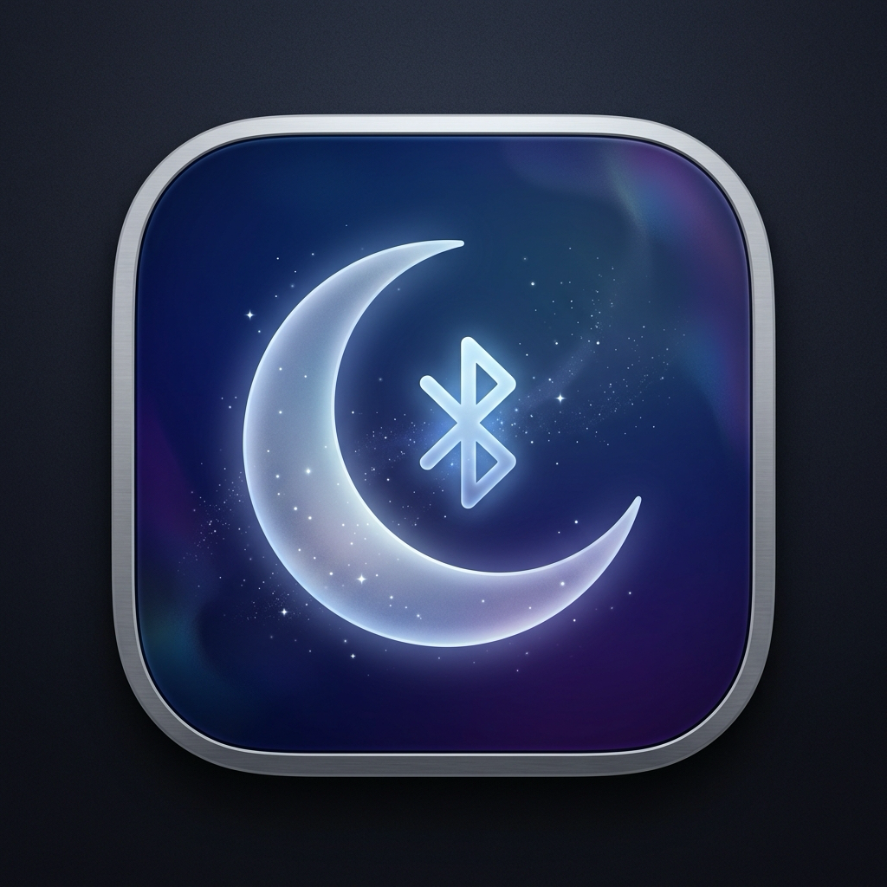

# BlueNap (蓝憩)

<p align="center">
  <br />
  <b>Sleeping Mac, Silent Bluetooth & Intelligent Auto-WiFi.</b><br />
  <i>意境优雅的 Mac 蓝牙与 Wi-Fi 深度休眠管理 · 原生 AutoWiFi 静态 IP 智能自动绑定 · 让设备管理恬静自如</i>
</p>

<p align="center">
  
</p>

<p align="center">
  <a href="https://app.needai.top/app/bluenap"></a>
  <a href="https://app.needai.top/app/tactile"></a>
  
  
  
  
  
  <a href="https://github.com/jorchford/BlueNap"></a>
</p>

---

[English](#english) | [中文说明](#中文说明)

---

<a name="english"></a>
## English

### Overview

**BlueNap (蓝憩) elegantly prevents your sleeping Mac from hijacking paired Bluetooth accessories.**

When you share Bluetooth headphones, earbuds (such as AirPods), or speakers between your Mac and iPhone/iPad, a sleeping Mac can intermittently connect in the background during maintenance wakeups or power assertions, abruptly interrupting your audio or draining accessory battery.

**BlueNap** provides an intuitive, serene solution:
- When your Mac **goes to sleep**, BlueNap automatically disconnects selected audio accessories or gracefully switches off Bluetooth entirely.
- When your Mac **wakes up and is unlocked**, BlueNap restores your previous state seamlessly.
- Optionally applies the same power lifecycle management for **Wi-Fi**.
- **AutoWiFi Intelligent Static IP Auto-Switching**: Detects your connected Wi-Fi SSID and automatically applies customized static IP, subnet, router, and DNS settings. When leaving, it restores DHCP automatically. Powered by a native Swift LaunchDaemon with 0.0% CPU and zero polling.

---

### What's New in Version 2.1.0

1. **AutoWiFi Static IP Auto-Binding Subsystem**
   - Seamlessly switches between DHCP and custom static IP profiles matching office/lab/home SSIDs.
   - Master switch to enable/disable auto-binding anytime, with individual per-profile toggles.
   - Pure Swift native background daemon (`bluenap-wifid`) replacing legacy shell scripts, consuming 0.0% CPU via kernel `SCDynamicStore` event-driven notifications.
   - Full daemon lifecycle management directly within the UI: install, start, stop, restart, and uninstall.
   - Live network card, IPv4 validation, and one-tap DNS presets (AliDNS, DNSPod, 114DNS, Cloudflare, Google).

2. **Swift 6 Complete Concurrency Architecture**
   - Fully compiled under `SWIFT_STRICT_CONCURRENCY = complete` with zero concurrency warnings or race conditions.
   - Actor-isolated hardware managers: [`BluetoothService`](src/Bluesnooze/Classes/BluetoothService.swift) and [`WiFiService`](src/Bluesnooze/Classes/WiFiService.swift) ensure all hardware control and I/O tasks execute off the main thread.
   - Unified reactive UI state model driven by `@Observable` and `@MainActor` ([`AppState`](src/Bluesnooze/Classes/AppState.swift) and [`Preferences`](src/Bluesnooze/Classes/Preferences.swift)).

2. **Liquid Glass SwiftUI Preferences Panel**
   - Replaced clunky nested menus with a native, responsive SwiftUI Settings window ([`PreferencesView`](src/Bluesnooze/Classes/PreferencesView.swift)).
   - Dedicated tabs for **Bluetooth**, **Wi-Fi**, **General**, and **About**.
   - Live paired Bluetooth accessories list with intelligent SF Symbol classification.
   - Automatic protection for HID input devices (mice, keyboards, trackpads) to eliminate accidental disconnection.

3. **Background-Only Daemon Mode (Hide Menu Bar Icon)**
   - Option to completely hide the status bar icon while keeping the background sleep/wake listener active.
   - **Failsafe Re-summon**: Simply relaunching BlueNap via Spotlight, Finder, or Terminal automatically restores the Settings window.

4. **Comprehensive Localization (English & 简体中文)**
   - Complete Chinese translation across menu bars, settings panels, alerts, and VoiceOver accessibility labels.

5. **Apple Notarized & Direct Distribution**
   - Officially notarized by Apple (`source=Notarized Developer ID`), guaranteed Gatekeeper trust with zero quarantine blocks.

---

### 🌟 More macOS Apps from Developer

* **[Tactile (妙触)](https://app.needai.top/app/tactile)** — Next-Generation 120Hz ProMotion Multitouch Gesture Powerhouse & Stroke Drawing Engine for macOS. Buttery-smooth, native-grade trackpad & Magic Mouse gesture enhancements.
* **[Official Website (BlueNap)](https://app.needai.top/app/bluenap)** — Discover more commercial-grade native macOS & iOS utilities crafted for speed and elegance.

---

### System Requirements

* **Operating System**: macOS 14.0 (Sonoma) or macOS 15.0+ (Sequoia).
* **Architecture**: Universal (Apple Silicon M1/M2/M3/M4 & Intel x86_64).
* **Build Tool**: Xcode 16.0+ (Swift 6.0).

---

<a name="中文说明"></a>
## 中文说明

### 项目简介

**蓝憩 (BlueNap)** 是一款专为 Mac 用户精心打造的「意境优雅风」蓝牙与 Wi-Fi 深度休眠管理工具。

当您在 iPhone/iPad 与 Mac 之间共用蓝牙耳机（如 AirPods）或无线音箱时，休眠中的 Mac 经常会因系统后台维护（Power Nap、网络唤醒）意外“抢连”蓝牙耳机，打断您的手机听歌通话，或在背包中悄悄耗尽耳机电量。

**蓝憩** 赋予您的 Mac 恬静的睡眠体验：
- **Mac 入睡**：合盖或进入睡眠时，蓝憩立即断开指定的蓝牙音频设备或完全关闭蓝牙电源；
- **Mac 醒来**：屏幕唤醒并解锁后，瞬间自动还原休眠前的外设与网络状态；
- **AutoWiFi 静态 IP 智能绑定**：全自动感知当前连接的 Wi-Fi SSID，毫秒级切换为对应网络预设的静态 IPv4、子网掩码、网关与 DNS，离开或断开自动恢复 DHCP。内置纯原生 Swift LaunchDaemon 守护进程，内核级事件驱动，零轮询、0.0% CPU 占用；
- **输入外设安全守卫**：全自动识别蓝牙鼠标、触控板与键盘，坚决不误断输入设备，确保蓝牙唤醒顺畅无阻。

---

### 核心特性 (v2.1.0)

1. **AutoWiFi 智能网络绑定引擎**
   - 告别繁琐的终端命令与 Shell 脚本，由纯 Swift 原生守护进程驱动。
   - 提供全局主开关与单网络独立开关，自由掌控是否绑定静态 IP。
   - 偏好设置面板内原生一键安装、启动、停止、重启与彻底卸载后台 LaunchDaemon 守护进程。
   - 实时网络状态看板（显示当前连接 SSID、IP、掩码、网关与 DNS），自带“立即应用规则”与“使用当前网络配置”。
   - 预设常用高速 DNS（阿里、腾讯 DNSPod、114DNS、Cloudflare、Google）。
2. **Swift 6 全并发安全架构**
   - 彻底开启 `SWIFT_STRICT_CONCURRENCY = complete`，严格消除数据竞争。
2. **Liquid Glass 流光玻璃偏好设置**
   - 专为 macOS Sonoma/Sequoia 设计的高级磨砂拟物面板，支持独立勾选任意已配对设备，实时响应。
3. **后台极简静默模式**
   - 支持彻底隐藏状态栏图标，后台持续监听休眠事件；只需从聚焦搜索（Spotlight）再次启动蓝憩，即可随时唤回设置。
4. **全语言原生适配**
   - 包含完整的简体中文（`zh-Hans`）与英文（`en`）支持，状态提示、动效反馈与 VoiceOver 盲人读屏完全本土化。
5. **苹果官方公证 (Notarized)**
   - 已通过 Apple 官方安全扫描公证，搭载 Developer ID 权威签名，下载即开，无拦截弹窗。

---

### 🌟 更多开发者独立作品

* **[Tactile (妙触)](https://app.needai.top/app/tactile)**：macOS 120Hz 全能多点触控与笔画手势神器。独创单指驻留滑动、流光轨迹绘字识别、妙控鼠标全表面增强，榨干触控板潜能。
* **[官方应用主页 (BlueNap)](https://app.needai.top/app/bluenap)**：汇聚个人独立开发的高品质 Apple 生态原生应用，欢迎体验。

---

### 源码编译指南

```bash
# 克隆仓库
git clone https://github.com/jorchford/BlueNap.git
cd BlueNap

# 执行 Release 编译
xcodebuild -project src/Bluesnooze.xcodeproj \
           -scheme Bluesnooze \
           -configuration Release \
           build
```

---

### 开发者信息
* **支持我喝杯咖啡**：[https://afdian.com/item/383f394ccd6011f1a9ec5254001e7c00](https://afdian.com/item/383f394ccd6011f1a9ec5254001e7c00)
* **官方展示页面**：[https://app.needai.top](https://app.needai.top)
* **GitHub 仓库**：[https://github.com/jorchford/BlueNap](https://github.com/jorchford/BlueNap)
* **更多 macOS 神器**：[https://github.com/jorchford/tactile](https://github.com/jorchford/tactile)
* **作者**：[ Jorchford](https://github.com/jorchford)
