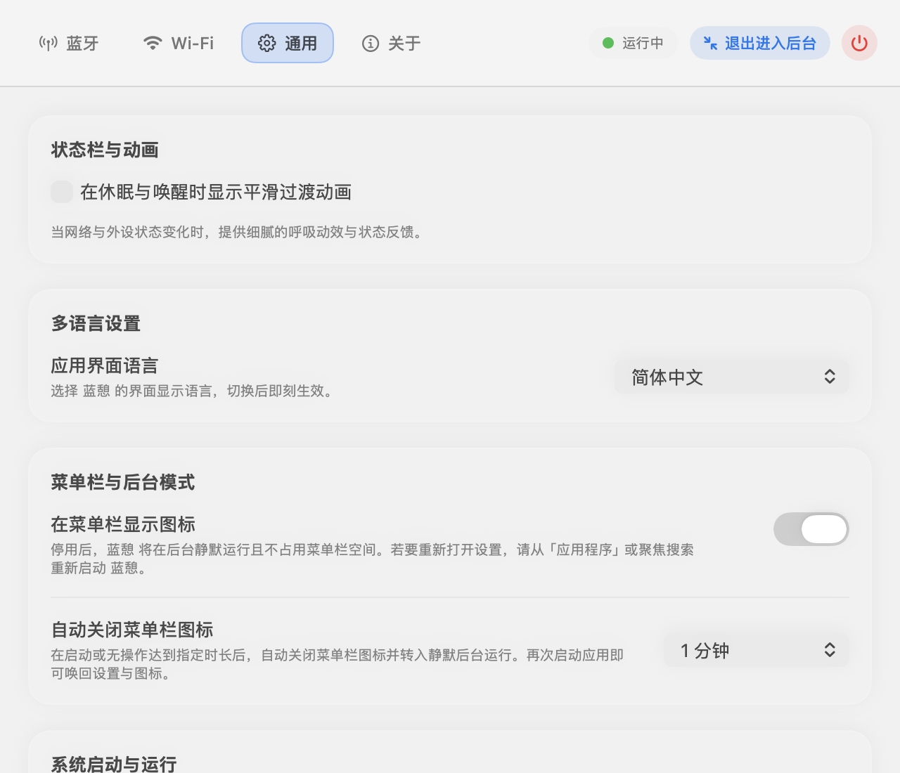
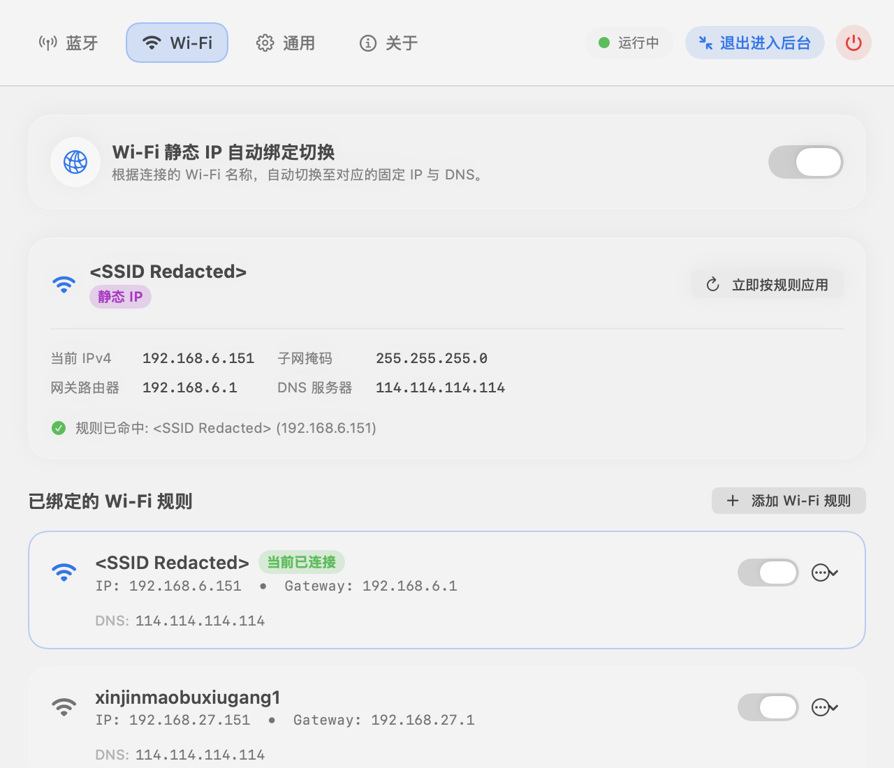
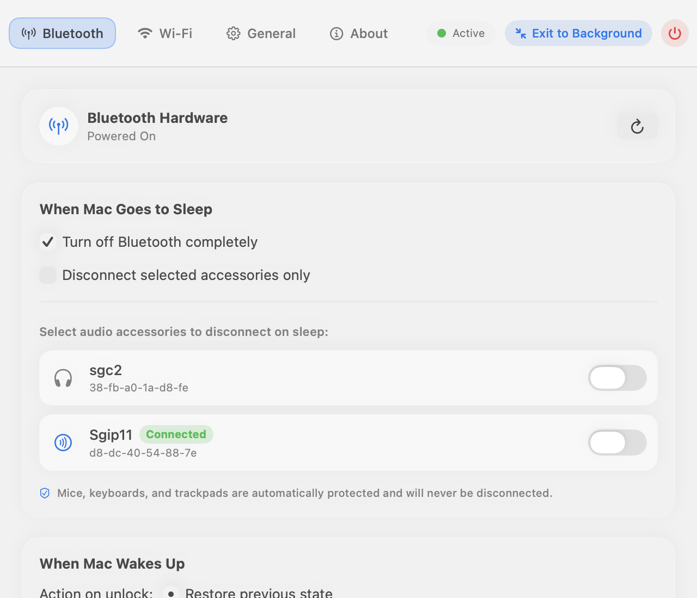
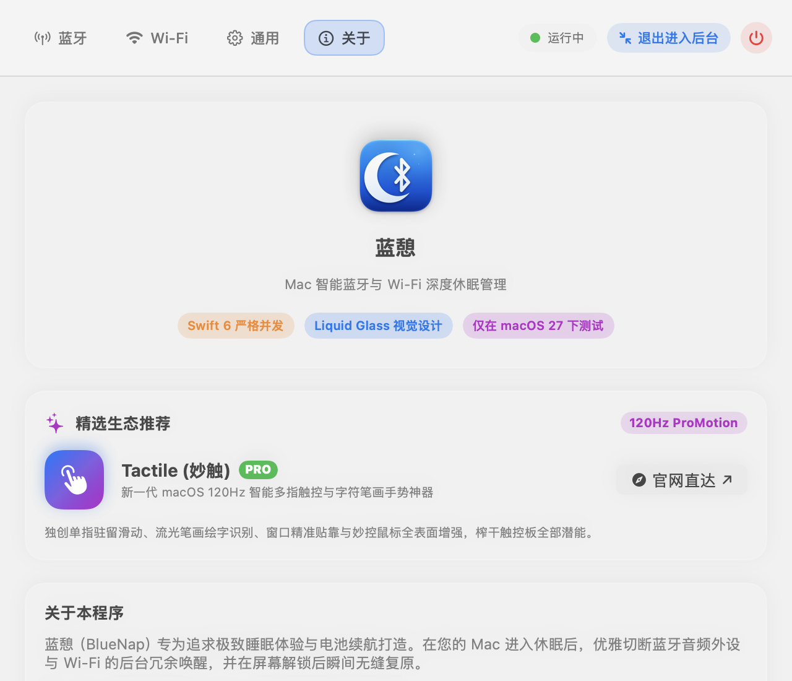

# BlueNap (蓝憩)

   
  <b>Sleeping Mac, Silent Bluetooth & Intelligent Auto-WiFi.</b> 
  <i>意境优雅的 Mac 蓝牙与 Wi-Fi 深度休眠管理 · 原生 AutoWiFi 静态 IP 智能自动绑定 · 让设备管理恬静自如</i>

  
  
  
  
  
  
  
  
  
  

  <b>⚡ 极速下载镜像通道:</b> 
  <a href="https://www.needai.top/downloads/BlueNap.app.zip">🌐 官网直链 (www.needai.top)</a> &nbsp;|&nbsp;
  <a href="https://gitee.com/jorchford/BlueNap/raw/main/downloads/BlueNap.app.zip">⚡ Gitee 国内极速直链</a> &nbsp;|&nbsp;
  <a href="https://github.com/jorchford/BlueNap/releases">📦 GitHub Releases</a>

  <b>语言导航 / Language Navigation:</b> &nbsp;
  <a href="README.md">English</a> &nbsp;|&nbsp;
  <b>简体中文</b> &nbsp;|&nbsp;
  <a href="#繁體中文">繁體中文</a> &nbsp;|&nbsp;
  <a href="#日本語">日本語</a>

---

## 📸 界面效果展示 (Screenshots)

### 1. 通用设置与后台运行 (General Preferences & Silent Background Mode)
*登录时自动启动、退出进入后台、完全退出应用、以及菜单栏自动隐藏选项*

  

### 2. AutoWiFi 静态 IP 智能绑定与系统守护服务 (AutoWiFi Subsystem)
*自动感知已连接 SSID，毫秒级切换静态 IPv4 与 DNS，纯原生 Swift LaunchDaemon 守护*

  

### 3. 蓝牙休眠管理与外设防抢连 (Bluetooth Sleep Management)
*Mac 合盖或休眠时，自动断开指定的 AirPods 或无线音频外设，防止声音截断与电池偷跑*

  

### 4. 关于与触控神器生态互通 (About & Tactile Ecosystem)
*Swift 6 严格并发架构，Liquid Glass 质感界面，支持生态产品推荐*

---

## 简体中文

### 概述

**BlueNap (蓝憩) 旨在优雅解决 Mac 处于休眠状态时仍意外连接、抢占已配对蓝牙耳机/音响的问题。**

当你在 iPhone、iPad 与 Mac 之间共用同一副蓝牙耳机（如 AirPods）或无线音箱时，合盖或处于睡眠中的 Mac 常常会因“维护唤醒 (Power Nap)”或后台常驻进程，在毫无预警的情况下自动重连耳机，导致正在手机上播放的音乐、播客或通话瞬间被掐断，同时造成耳机与外设电池电量无谓消耗。

**BlueNap 提供了一套直观而惬意的解决方案：**
- 当 Mac **进入休眠** 时，BlueNap 会瞬间切断指定的音频设备连接，或彻底关闭蓝牙模块；
- 当 Mac **开盖并解锁屏幕** 时，BlueNap 瞬间自动恢复休眠前的原始状态；
- **AutoWiFi 静态 IP 智能绑定**：全自动感知当前连接的 Wi-Fi SSID，毫秒级切换为对应网络预设的静态 IPv4、子网掩码、网关与 DNS，离开或断开自动恢复 DHCP。内置纯原生 Swift LaunchDaemon 守护进程，内核级事件驱动，零轮询、0.0% CPU 占用；
- **输入外设安全守卫**：全自动识别蓝牙鼠标、触控板与键盘，坚决不误断输入设备，确保蓝牙唤醒顺畅无阻；
- **退出进入后台与极致低内存**：关闭窗口时彻底销毁 SwiftUI 视图图谱与 Darwin 堆内存压力释放，后台常驻物理内存仅 **~12.2 MB**。

---

### 核心特性 (v2.2.0)

1. **退出进入后台与菜单栏快捷操作**
   - 菜单栏状态菜单中在「退出 蓝憩」正上方新增 **「退出进入后台」** 选项。
   - 通用设置界面与顶栏同步提供「退出进入后台」快捷胶囊，点击后隐藏状态栏图标并彻底释放窗口内存，静默常驻后台守护。
2. **应用内与菜单栏多语言即时切换**
   - 菜单栏新增专用的 **「界面语言 (Language)」** 子菜单并显示当前语言勾选标记（`✓`）。
   - 原生支持简体中文、繁体中文、英文与日文，在偏好设置或菜单栏切换后全界面即刻生效。
3. **AutoWiFi 静态 IP 自动化子系统**
   - 支持多套 Wi-Fi 规则独立配置，连接特定 SSID 时秒级应用静态 IP/DNS，断开或切换其他 Wi-Fi 自动切回 DHCP。
4. **极致内存释放与性能调优**
   - 关闭设置窗口时强制替换根视图为 `EmptyView()`，销毁 `NSHostingController` 与窗口对象，多级清空 CoreAnimation 事务与 Darwin Malloc 内存区。
5. **隐私安全声明与零遥测**
   - 坚持 100% 本地纯离线运行，绝不收集、追踪或上传任何设备与个人隐私数据。

---

## 繁體中文

### 概述

**BlueNap (藍憩)** 是一款專為 macOS 量身打造的原生輕量工具，旨在徹底終結 Mac 睡眠休眠時偷連、搶佔藍牙耳機及音響的困擾。

當你在 iPhone、iPad 與 Mac 之間共用 AirPods 或無線藍牙喇叭時，即使闔上 Mac 螢幕，系統在睡眠期間仍可能因背景維護喚醒而自動重連耳機，造成音樂截斷與耳機耗電。

**BlueNap** 帶來純淨自如的體驗：
- **Mac 休眠時**：秒級切斷指定音訊設備連線，或關閉藍牙模組；
- **Mac 解鎖時**：立即無縫復原休眠前的連線狀態；
- **AutoWiFi 靜態 IP 智慧切換**：依照當前連線的 Wi-Fi SSID 自動套用固定 IP 與 DNS，離開時自動恢復 DHCP。

---

## 日本語

### 概要

**BlueNap (藍憩)** は、Mac がスリープ中にペアリングされた Bluetooth 音声機器（AirPods やワイヤレススピーカーなど）を勝手にハイジャックして接続してしまうのを防ぐ、エレガントで軽量な macOS 向け電源管理ユーティリティです。

iPhone や iPad と Mac で Bluetooth イヤホンを共有している場合、Mac がスリープに入ってもシステム保守（Power Nap など）で意図せず再接続され、iPhone での音楽再生や通話が遮断されたり、イヤホンのバッテリーが消耗してしまうことがあります。

**BlueNap の主な特長：**
- **Mac スリープ時**：指定したオーディオ機器を自動切断、または Bluetooth を自動的にオフにします。
- **Mac ロック解除時**：スリープ前の接続状態を瞬時に自動復元します。
- **多言語切り替え**：メニューバーおよび環境設定から即座に日本語・英語・簡体字・繁体字を切り替え可能。
- **AutoWiFi 固定 IP 自動切り替え**：接続中の Wi-Fi SSID を検知し、オフィス・自宅に応じた固定 IP や DNS 設定へ自動切り替え。
- **極小メモリ設計**：バックグラウンド待機時の物理メモリはわずか **~12.2 MB**。

---

## 🤝 官方生态推荐

* **[Tactile (妙触)](https://www.needai.top/app/tactile)**：macOS 120Hz 全能多点触控与笔画手势神器。独创单指驻留滑动、流光轨迹绘字识别、妙控鼠标全表面增强，榨干触控板潜能。
* **[官方展示页面 (BlueNap)](https://www.needai.top/app/bluenap)**：汇聚个人独立开发的高品质 Apple 生态原生应用，欢迎体验。

---

## 📄 许可证

BlueNap 采用 [GNU 通用公共许可证 v3.0 (GPLv3)](LICENSE) 开源，欢迎提交 Issue 与 Pull Request！
